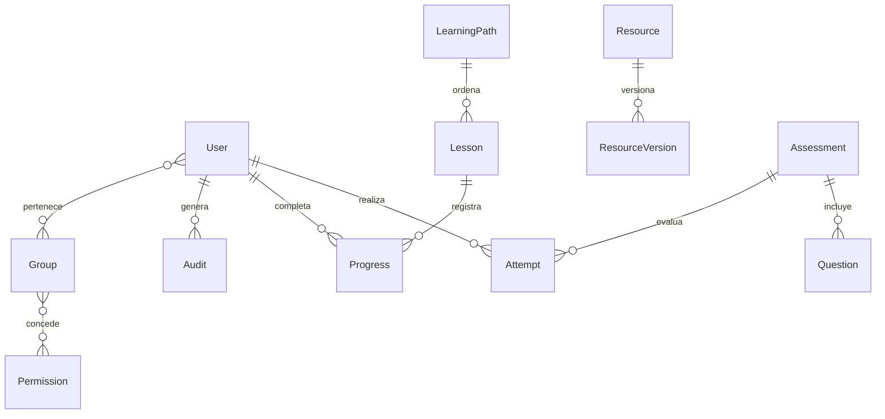

# Arquitectura, datos y operación

Navegador → Django templates + Bootstrap local + CSS → vistas Django → ORM → PostgreSQL. Chart.js dibuja datos agregados en el navegador. openpyxl genera y valida archivos Excel. El almacenamiento se encuentra en `private_storage`, sin URL MEDIA pública; la descarga pasa por autenticación y verifica que el recurso esté publicado.

## Modelo de datos



| Entidad | Campos y reglas |
|---|---|
| User/Group/Permission | Autenticación estándar Django, grupos y permisos por modelo |
| Resource | Título, área, tipo, descripción, URL y publicado |
| ResourceVersion | Recurso FK, número, notas, archivo, fecha; unicidad recurso+número |
| LearningPath | Título, área y descripción |
| Lesson | Ruta FK, título, cuerpo y posición; orden de lectura |
| Progress | Usuario FK y lección FK; par único, completar es idempotente |
| Assessment | Título, área, minutos y umbral de aprobación |
| Question | Evaluación FK, enunciado, opciones JSON, índice correcto y explicación |
| Attempt | Usuario FK, evaluación protegida, inicio, deadline, respuestas JSON, cerrado, puntaje, actualización |
| Audit | Usuario nullable, acción y fecha; los registros del administrador también usan LogEntry de Django |

Las migraciones iniciales están incluidas. El esquema usa tipos compatibles con PostgreSQL y SQLite. Los archivos no están dentro de static y no se publican con el servidor web.

## Matriz de permisos inicial

| Acción | Participante | Editor | Evaluador | Administrador |
|---|---|---|---|---|
| Ver catálogo y descargar publicado | Sí | Sí | Sí | Sí |
| Progreso, examen y resultados propios | Sí | Sí | Sí | Sí |
| Editar recursos/versiones/rutas/lecciones | No | Sí | No | Sí |
| Banco, importar y editar evaluaciones | No | No | Sí | Sí |
| Reportes globales, auditoría, respaldo contenido | No | No | Sí | Sí |
| Usuarios, roles y configuración | No | No | No | Sí |

`hub.view_audit` habilita reportes, auditoría y exportación de contenido en esta demo. Conviene separar esos permisos en producción si las responsabilidades lo requieren. Cambiar la matriz se hace desde grupos Django Admin. El participante no tiene acceso staff. El editor y evaluador solo pueden administrar modelos expresamente concedidos. La API de intentos filtra por propietario incluso para staff.

## Exámenes

Inicio por POST con CSRF. Reutiliza un intento abierto y fija deadline del servidor. Guardado por JSON y POST, valida IDs y rangos, bloquea la fila con transacción en PostgreSQL, rechaza respuestas tras deadline y calcula nota al cerrar. El cliente guarda al cambiar y cada 10 segundos; las escrituras se serializan y el envío final espera su confirmación. El tiempo del navegador solo controla la visualización. Si no hay tráfico después del vencimiento, el intento se cierra en la próxima petición; no hay proceso programado. No se envían respuestas correctas al navegador del examen. El sistema no es una plataforma de supervisión de exámenes.

## Importación

Plantilla de siete columnas: evaluacion_id, pregunta, opcion_a, opcion_b, opcion_c, correcta_0_2, explicacion. Hasta 2 MB y 500 registros. Valida encabezados, campos, referencia e índice. Todo el lote se inserta en una transacción y un error revierte las filas anteriores. Solo evaluadores/admin. No se interpretan fórmulas. Antes de habilitar archivos de terceros en producción, incorporar límites de descompresión del ZIP XLSX y escaneo de adjuntos. Los reportes actuales contienen nombres y títulos controlados por administración; si se admiten entradas no confiables debe neutralizarse la inyección de fórmulas en exportaciones.

## Respaldo completo PostgreSQL

Detener escrituras durante la copia para mantener coherencia. Configurar PGPASSWORD fuera del historial del terminal. Desde herramientas PostgreSQL:

```powershell
pg_dump -h localhost -U qahub -Fc -f qa-db.dump qahub
Copy-Item -LiteralPath private_storage -Destination backups/private_storage -Recurse
# Restaurar en una base vacía, con la misma versión del código:
pg_restore -h localhost -U qahub -d qahub_restore qa-db.dump
Copy-Item -LiteralPath backups/private_storage -Destination private_storage -Recurse
python manage.py check
```

La carpeta destino debe estar vacía y su padre debe existir. Conservar juntos dump, adjuntos, versión del código y manifiesto de fecha; guardar secretos por un canal separado. Probar restauración periódicamente en un entorno aislado. El respaldo web JSON sirve para contenido; no sustituye pg_dump ni incluye archivos o identidades.

## Preparación para un entorno real

Cambiar credenciales demo y secreto; DEBUG=0; configurar hosts reales, HTTPS y cookies Secure; usar un servidor WSGI/ASGI gratuito compatible y proxy; recoger static; limitar intentos de login, tamaño de cargas y acceso a respaldos; retirar seed y proteger el volumen con permisos del sistema operativo. Mantener PostgreSQL con privilegios mínimos. Ejecutar `manage.py check --deploy` y revisar sus advertencias. No apuntar MEDIA_ROOT como directorio público de Nginx/Apache. La auditoría del prototipo registra descargas, exámenes, importaciones, reportes y exportaciones; no es un registro inmutable ni cubre todos los accesos.

## Evolución prioritaria

Congelar preguntas por versión del examen, asignaciones por equipo, transacciones para inicios simultáneos, reproducción de videos con peticiones de rango, subida validada fuera de Admin, auditoría inmutable y recuperación de contraseña. Conservar el diseño visual y sustituir gradualmente los formularios de Admin cuando se necesiten flujos editoriales más específicos.
