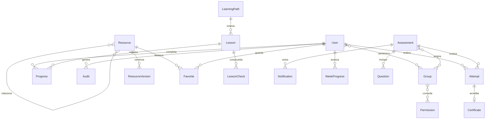

# Arquitectura, datos y operación

Navegador → Django templates + Bootstrap local + CSS → vistas Django → ORM → PostgreSQL. Chart.js dibuja datos agregados en el navegador. openpyxl genera y valida archivos Excel. El almacenamiento se encuentra en `private_storage`, sin URL MEDIA pública; la descarga pasa por autenticación y verifica que el recurso esté publicado.

## Modelo de datos



| Entidad | Campos y reglas |
|---|---|
| User/Group/Permission | Autenticación estándar Django, grupos y permisos por modelo |
| Resource | Título, área y tipo (con opciones válidas), descripción, URL, publicado, etiquetas, recursos relacionados (relación simétrica) y `landing` (curso semanal que abre en lugar de la ficha) |
| Favorite | Usuario y recurso; par único |
| LessonCheck | Lección FK, enunciado, opciones, índice correcto y explicación; si la lección tiene alguna, hay que acertarlas todas para completarla |
| Notification | Usuario, evaluación y tipo (`assigned`, `closing`); evita repetir avisos |
| Certificate | Intento aprobado (uno a uno), código único `CICC-XXXXXXXXXX` y fecha de emisión |
| CourseWeek | Curso, número, título opcional y HTML de una semana editable; si existe, sustituye al archivo incluido |
| WeekProgress | Usuario, curso y semana completada; par único |
| ResourceVersion | Recurso FK, número, notas, archivo, fecha; unicidad recurso+número |
| LearningPath | Título, área y descripción |
| Lesson | Ruta FK, título, cuerpo y posición; orden de lectura |
| Progress | Usuario FK y lección FK; par único, completar es idempotente |
| Assessment | Título, área, minutos, umbral de aprobación e intentos máximos (0 = sin límite), preguntas por intento (0 = todas), grupos asignados (vacío = todos) y fechas de apertura y cierre |
| Question | Evaluación FK, tipo (`single`, `multiple`, `truefalse`, `short`), enunciado, opciones JSON, índice correcto, conjunto correcto (múltiple), respuestas aceptadas (corta), explicación y tema opcional |
| Attempt | Usuario FK, evaluación protegida, inicio, deadline, respuestas JSON, copia de las preguntas (`snapshot`), cerrado, fecha de cierre, puntaje, actualización. Restricción: un solo intento abierto por usuario y evaluación |
| Audit | Usuario nullable, acción y fecha; los registros del administrador también usan LogEntry de Django |

Las migraciones iniciales están incluidas. El esquema usa tipos compatibles con PostgreSQL y SQLite. Los archivos no están dentro de static y no se publican con el servidor web.

## Matriz de permisos inicial

| Acción | Participante | Editor | Evaluador | Administrador |
|---|---|---|---|---|
| Ver catálogo y descargar publicado | Sí | Sí | Sí | Sí |
| Progreso, examen y resultados propios | Sí | Sí | Sí | Sí |
| Editar recursos/versiones/rutas/lecciones | No | Sí | No | Sí |
| Banco, importar y editar evaluaciones | No | No | Sí | Sí |
| Reportes globales, auditoría, respaldo contenido | No | No | Sí | Sí |
| Usuarios, roles y configuración | No | No | No | Sí |

`hub.view_audit` habilita reportes, auditoría y exportación de contenido en esta demo. Conviene separar esos permisos en producción si las responsabilidades lo requieren. Cambiar la matriz se hace desde grupos Django Admin. El participante no tiene acceso staff. El editor y evaluador solo pueden administrar modelos expresamente concedidos. La API de intentos filtra por propietario incluso para staff.

## Exámenes

Inicio por POST con CSRF. Reutiliza un intento abierto (la restricción de base de datos evita duplicados por clics simultáneos), respeta el límite de intentos, guarda una copia ordenada al azar de las preguntas y fija el deadline del servidor. Todo cálculo posterior usa esa copia. Guardado por JSON y POST, valida IDs y rangos, bloquea la fila con transacción en PostgreSQL, rechaza respuestas tras deadline y calcula nota al cerrar. El cliente guarda al cambiar y reintenta cada 10 segundos solo si hay cambios sin confirmar; las escrituras se serializan y el envío final (con resumen de pendientes) espera su confirmación. Un intento vencido se califica al abrirlo, al guardar o al iniciar otro. El tiempo del navegador solo controla la visualización. Si no hay tráfico después del vencimiento, el intento se cierra en la próxima petición; no hay proceso programado. No se envían respuestas correctas ni explicaciones al navegador del examen. El sistema no es una plataforma de supervisión de exámenes.

## Tipos de pregunta y sorteo

La respuesta se guarda según el tipo: número (única y verdadero/falso), lista de números (múltiple) o texto (corta). `hub/services.py` centraliza la corrección (`is_correct`), la validación de forma de lo que llega del navegador (`valid_answer`) y el sorteo por temas (`draw_questions`, por turnos entre temas). Las copias de intentos anteriores, sin tipo, se tratan como selección única. El navegador nunca recibe las respuestas correctas, el conjunto correcto ni las aceptadas.

## Cohortes, certificados y avisos

Una evaluación con grupos asignados solo aparece y puede iniciarse para sus miembros y para quien tenga permiso de gestionarla (el resto recibe 404). Las fechas de apertura y cierre bloquean solo el inicio; un intento en curso puede terminarse. Al calificar un intento aprobado se emite un certificado (idempotente). Tras confirmar la transacción se envía un correo con el resultado si la persona tiene dirección; un fallo de SMTP no interrumpe nada. `notify_assessments` avisa una sola vez (registro en `Notification`) de las evaluaciones abiertas asignadas a un grupo y de los plazos que vencen en menos de 48 horas. `close_expired` aplica el mismo proceso a los intentos vencidos y está pensado para ejecutarse periódicamente. La verificación `/certificate/<código>/` es pública por diseño.

## Respaldo y restauración

El respaldo usa claves naturales (usuarios y grupos por nombre, permisos por código) para poder restaurarse en otra instalación. La restauración web es solo para superusuarios, exige confirmación, acepta archivos de hasta 50 MB, solo restaura los modelos de CICC, sobrescribe objetos con el mismo ID, no toca a los usuarios que ya existen (los nuevos quedan sin contraseña) y se aplica en una transacción con comprobación de claves foráneas al final: si algo es inconsistente, no cambia nada.

## Video

`/stream/<id>/` reproduce versiones de recurso con extensión .mp4, .webm u .ogg solo a usuarios autenticados y de recursos publicados, con respuestas `206 Partial Content` para poder adelantar y retroceder. Los adjuntos se validan por extensión y tamaño al subirlos desde el administrador.

## Importación

Plantilla de siete columnas obligatorias (evaluacion_id, pregunta, opcion_a, opcion_b, opcion_c, correcta_0_2, explicacion) y una octava opcional, tema. Hasta 2 MB y 500 registros. Valida encabezados, campos, referencia, índice y las reglas de `Question.clean`; informa hasta 10 errores por fila. Todo el lote se inserta en una transacción y un error no guarda nada. Se ignoran las filas totalmente vacías. Solo evaluadores/admin. No se interpretan fórmulas. Antes de habilitar archivos de terceros en producción, incorporar límites de descompresión del ZIP XLSX y escaneo de adjuntos. Los reportes actuales contienen nombres y títulos controlados por administración; las exportaciones neutralizan los valores que empiezan por = + - @ para evitar inyección de fórmulas.

## Respaldo completo PostgreSQL

Detener escrituras durante la copia para mantener coherencia. Configurar PGPASSWORD fuera del historial del terminal. Desde herramientas PostgreSQL:

```powershell
pg_dump -h localhost -U qahub -Fc -f qa-db.dump qahub
Copy-Item -LiteralPath private_storage -Destination backups/private_storage -Recurse
# Restaurar en una base vacía, con la misma versión del código:
pg_restore -h localhost -U qahub -d qahub_restore qa-db.dump
Copy-Item -LiteralPath backups/private_storage -Destination private_storage -Recurse
python manage.py check
```

La carpeta destino debe estar vacía y su padre debe existir. Conservar juntos dump, adjuntos, versión del código y manifiesto de fecha; guardar secretos por un canal separado. Probar restauración periódicamente en un entorno aislado. El respaldo web JSON incluye contenido, intentos, grupos y usuarios sin contraseña, y se restaura con `python manage.py loaddata cicc-content-backup.json` sobre una base migrada y vacía (los usuarios necesitan una contraseña nueva con `changepassword`). No sustituye pg_dump ni incluye archivos adjuntos.

## Preparación para un entorno real

Cambiar credenciales demo y secreto; `DEBUG=0` (exige `DJANGO_SECRET_KEY` y activa cookies Secure, redirección HTTPS y HSTS); configurar hosts reales; usar un servidor WSGI/ASGI gratuito compatible y proxy (WhiteNoise sirve `static/`); el login ya limita intentos fallidos, pero con varias instancias hay que configurar una caché compartida; limitar tamaño de cargas y acceso a respaldos; retirar seed y proteger el volumen con permisos del sistema operativo. Mantener PostgreSQL con privilegios mínimos. Ejecutar `manage.py check --deploy` y revisar sus advertencias. No apuntar MEDIA_ROOT como directorio público de Nginx/Apache. La auditoría del prototipo registra descargas, exámenes, importaciones, reportes y exportaciones; no es un registro inmutable ni cubre todos los accesos.

## Evolución prioritaria

Asignaciones por equipo, reproducción de videos con peticiones de rango, editor propio de preguntas, subida validada fuera de Admin, auditoría inmutable y recuperación de contraseña. Conservar el diseño visual y sustituir gradualmente los formularios de Admin cuando se necesiten flujos editoriales más específicos.
