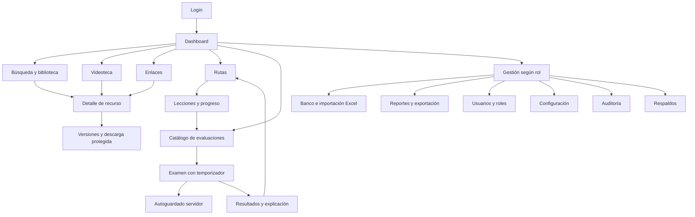

# Diseño y navegación

## Lenguaje visual

Marco común: barra lateral azul tinta #101e35, tipografía del sistema, tarjetas con bordes suaves, espacios amplios, foco de teclado y contenido en español. Formularios con etiquetas y estados vacíos. A menos de 760 px la navegación se convierte en una fila desplazable y las tarjetas se apilan.

| Familia | Pantallas | Paleta y tratamiento |
|---|---|---|
| Ejecutivo | Dashboard y administración | Azul oscuro, hero con órbitas CSS, indicadores y accesos rápidos |
| Biblioteca | Búsqueda, recursos, versiones, videoteca y enlaces | Fondos claros, verde salvia, tarjetas por formato |
| Evaluaciones | Catálogo y examen activo | Fondo oscuro, violeta, opciones amplias y tiempo destacado |
| Academia | Rutas y lecciones | Azul claro, pasos numerados, progreso persistente |
| Analítica | Reportes y resultados | Turquesa, gráfico de distribución y exportación Excel |

## Mapa

## Inventario de pantallas

| Pantalla / ruta | Contenido y navegación principal |
|---|---|
| `/login/` | Credenciales, errores y acceso al dashboard |
| `/` y `/p/dashboard/` | KPIs reales del catálogo y progreso, rutas, novedades y próximo desafío |
| `/p/library/` | Búsqueda por título, filtro de área, limpiar, tarjetas y estado sin resultados |
| `/resource/ID/` | Descripción, fuente, versiones, descarga y edición según permiso |
| `/p/videos/` | Catálogo filtrado de fichas de video; detalle con referencia externa |
| `/p/links/` | Fuentes externas con detalle y apertura en otra pestaña |
| `/p/paths/` | Rutas por área, orden de lecciones y entrada al aprendizaje |
| `/p/lessons/` | Contenido práctico, completar y estado persistente por usuario |
| `/p/assessments/` | Área, preguntas, duración, nota mínima, iniciar o reanudar |
| `/attempt/ID/` | Preguntas, opciones únicas, cuenta regresiva, estado de guardado y envío confirmado |
| `/p/results/` | Historial personal y enlace a cada resultado |
| `/results/ID/` | Puntaje, aprobación, aciertos, omisiones y explicaciones |
| `/p/questions/` | Banco, plantilla Excel, carga validada y acceso a edición |
| `/p/reports/` | Métricas del catálogo, gráfico Chart.js y exportación de intentos finalizados |
| `/p/users/` | Equipo, grupos, estado y acceso a altas/edición Django Admin |
| `/p/roles/` | Grupos, permisos explícitos y edición Django Admin |
| `/p/settings/` | Parámetros de infraestructura y acceso a configurar evaluaciones |
| `/p/audit/` | Últimos 100 eventos con usuario y fecha de Lima |
| `/p/backups/` | Descarga JSON autenticada; alcance y proceso de respaldo completo |

Todos los módulos conservan navegación lateral. Las secciones restringidas se ocultan al participante y también se validan en el servidor. El administrador Django ofrece formularios de alta, cambio, búsqueda y selección de registros.

## Datos de entrenamiento

Dos rutas, seis lecciones, dos evaluaciones, seis preguntas y seis recursos, cada uno con dos versiones. Ejercicios: conciliación batch, códigos de retorno, DB2, contratos REST, autenticación, trazabilidad de defectos y evidencia. Los nombres, usuarios y resultados son exclusivamente ficticios. Las imágenes ornamentales se dibujan con CSS, sin bancos de pago.

## Recorrido de aceptación visual

Revisar login, dashboard a 1440 px y móvil a 390 px; comprobar navegación horizontal en móvil, contraste de examen oscuro, etiquetas de entradas y foco de teclado. Revisar búsqueda sin resultados, usuario sin historial, error de importación, desconexión durante guardado y evaluación expirada. La fecha del encabezado es editorial de la demo; los eventos e intentos usan tiempo real.
